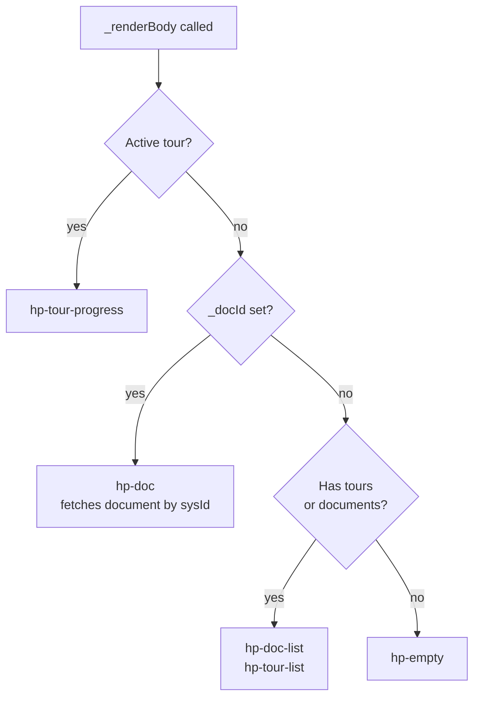
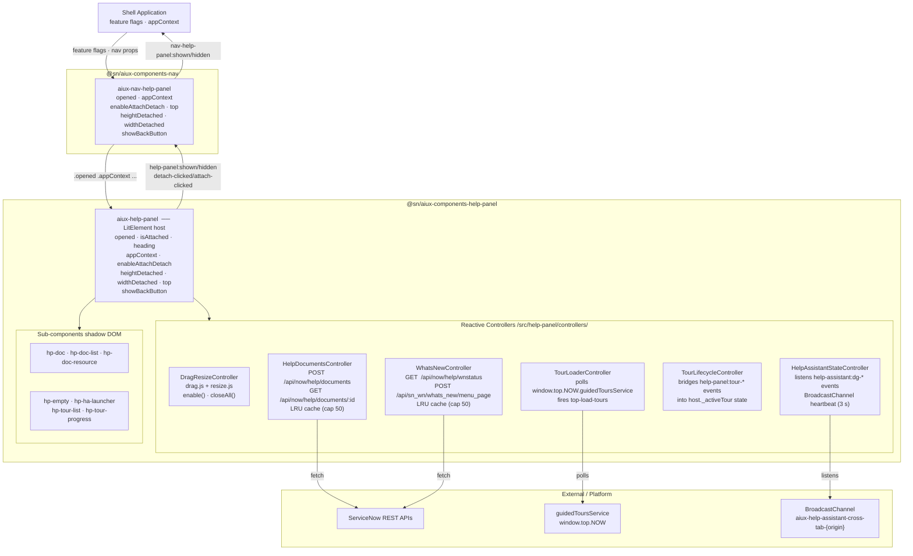
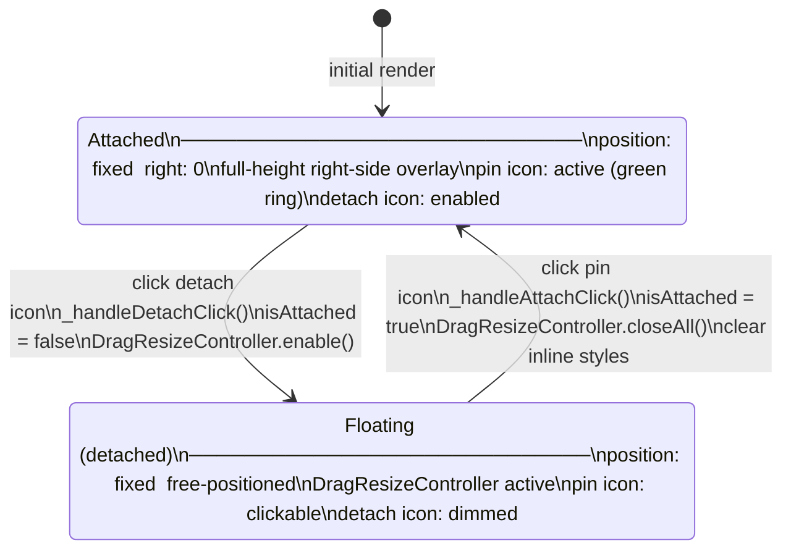

# help-panel

## Import

```js
import '@servicenow/aiux-components-help-panel';
```


A floating help panel for ServiceNow pages showing contextual documents, guided tours, and a What's New tab.

## Installation

```js
import '@servicenow/aiux-components-help-panel';
```

## Examples

### Basic — attached panel

```js
const panel = document.querySelector('aiux-help-panel');
panel.opened = true; // property-only — state: true, no HTML attribute
```

In a Lit template:

```js
html`<aiux-help-panel .opened=${true} heading="Help"></aiux-help-panel>`;
```

### With page context

Pass `appContext` as a **property** (not a JSON attribute) to avoid serialization issues:

```js
const panel = document.querySelector('aiux-help-panel');
panel.appContext = {
  type: 'custom', // 'custom' | 'classic'
  page: 'incident_list',
  app_route: 'now/sow',
  params: {}
};
panel.opened = true;
panel.visible = true;
```

### Detached (floating) mode

```html
<aiux-help-panel
  enable-attach-detach
  height-detached="640"
  width-detached="360"
></aiux-help-panel>
```

```js
// opened and isAttached are property-only (state: true, no HTML attribute)
const panel = document.querySelector('aiux-help-panel');
panel.opened = true;
panel.isAttached = false;
```

### Pinned — stays open on outside click

```js
html`<aiux-help-panel .opened=${true} pinned heading="Help"></aiux-help-panel>`;
```

### Programmatic control via properties

```js
const panel = document.querySelector('aiux-help-panel');

// Open the panel and load docs
panel.appContext = {
  type: 'custom',
  page: 'home',
  app_route: 'now/sow',
  params: {}
};
panel.opened = true;
panel.visible = true;

// Close the panel
panel.opened = false;

// Pre-load content without opening the panel (content fetches automatically when appContext changes)
panel.appContext = {
  type: 'custom',
  page: 'home',
  app_route: 'now/sow',
  params: {}
};
```

### With fixed page header

Use `top` to shift the panel below a fixed header so it doesn't overlap:

```js
html`<aiux-help-panel
  .opened=${true}
  top="56"
  heading="Help"
></aiux-help-panel>`;
```

## Properties

| Property                 | Attribute                    | Type      | Default   | Description                                                                                                                                                                    |
| ------------------------ | ---------------------------- | --------- | --------- | ------------------------------------------------------------------------------------------------------------------------------------------------------------------------------ |
| `opened`                 | — ¹                          | `Boolean` | `false`   | Show or hide the panel. **Property only** — use `.opened=${value}` in Lit templates or `element.opened = true` in JS.                                                          |
| `visible`                | `visible`                    | `Boolean` | `false`   | Controls CSS visibility (used for animation; keep in sync with `opened`)                                                                                                       |
| `heading`                | `heading`                    | `String`  | `'Help'`  | Panel heading text                                                                                                                                                             |
| `appContext`             | —                            | `Object`  | `null`    | Page context used to load contextual help documents. Shape: `{type, page, app_route, params}`. **Property only** — use `.appContext` binding. See [App Context](#app-context). |
| `isAttached`             | — ¹                          | `Boolean` | `true`    | Whether the panel is attached to the page edge (`true`) or floating detached (`false`). **Property only** — use `.isAttached=${value}` in Lit templates.                       |
| `enableAttachDetach`     | `enable-attach-detach`       | `Boolean` | `false`   | Show attach/detach icon in the panel header                                                                                                                                    |
| `pinned`                 | `pinned`                     | `Boolean` | `false`   | Keep the panel open (prevents auto-close on outside click)                                                                                                                     |
| `heightDetached`         | `height-detached`            | `Number`  | `580`     | Initial height in px when panel is in detached mode                                                                                                                            |
| `widthDetached`          | `width-detached`             | `Number`  | `320`     | Initial width in px when panel is in detached mode                                                                                                                             |
| `hideTabs`               | `hide-tabs`                  | `Boolean` | `false`   | Hide the Help / What's New tab bar                                                                                                                                             |
| `top`                    | `top`                        | `Number`  | `0`       | Top offset in px (use to account for fixed header height). Applied as an inline style when attached.                                                                           |
| `left`                   | `left`                       | `Number`  | `0`       | Left offset in px, applied as an inline style when attached. Mutually exclusive with `right` (`right` wins when both are `> 0`). `0` uses the host CSS default.                |
| `right`                  | `right`                      | `Number`  | `0`       | Right offset in px, applied as an inline style when attached. Takes precedence over `left` when both are `> 0`.                                                                |
| `position`               | `position`                   | `String`  | `'right'` | Side the panel is anchored to (`'right'`)                                                                                                                                      |
| `setInitialFocusInPanel` | `set-initial-focus-in-panel` | `Boolean` | `true`    | Move focus into the panel when it opens                                                                                                                                        |
| `enableHelpAssistant`    | `enable-help-assistant`      | `Boolean` | `true`    | Show the Help Assistant launcher inside the panel                                                                                                                              |
| `enableWhatsNew`         | `enable-whats-new`           | `Boolean` | `true`    | Enable the What's New flow. When `false`, `WhatsNewController` skips initialization and the What's New tab is never shown.                                                     |
| `showBackButton`         | `show-back-button`           | `Boolean` | `false`   | Show a chevron-left back button in the panel header. Set to `true` when the panel is opened from a secondary trigger (e.g. nav overflow button) so users can close and return. |

> **Note**: `width` and `height` are **not** props. Use `widthDetached` / `heightDetached` to set the initial size in detached (floating) mode only.

> ¹ Properties marked `— ¹` use `state: true` (Lit internal state) and have no corresponding HTML attribute. Set them via JS property assignment or Lit property binding (`.propName=${value}`). HTML attribute form (e.g. `<aiux-help-panel opened>`) has no effect.

## App Context

`appContext` tells the panel which contextual help documents to load. The panel posts this object to `/api/now/help/documents`.

| Field       | Type                      | Description                                                                                                                                                                               |
| ----------- | ------------------------- | ----------------------------------------------------------------------------------------------------------------------------------------------------------------------------------------- |
| `type`      | `'custom'` \| `'classic'` | Page type — `'classic'` uses the UI16 embedded help API                                                                                                                                   |
| `page`      | `string`                  | Page identifier used by the help API (e.g. `'home'`, `'incident_list'`)                                                                                                                   |
| `app_route` | `string`                  | Application route matching the `app_route` field on `help_guidance` records. UIB apps use `now/<app>` (e.g. `'now/sow'`); AICT and other AIUX apps use `aiux/<app>` (e.g. `'aiux/aict'`). |
| `params`    | `object`                  | Additional parameters passed to the API                                                                                                                                                   |

Results are cached in an LRU cache (see [Caching](#caching)).

## Detached Mode

### How it works

When `enableAttachDetach` is `true` and the user clicks the detach icon, `_handleDetachClick`:

1. Sets `isAttached = false` — the panel becomes `position: fixed` via CSS.
2. Dispatches `help-panel:detach-clicked` (bubbles, composed) for the nav wrapper to react to.
3. `updated()` fires, detects `isAttached` changed to `false`, and calls `DragResizeController.enable()` — attaching mouse and keyboard drag to the header, and wiring the resize handle in the footer.

Clicking the attach icon reverses this: `isAttached = true`, `DragResizeController.closeAll()`, inline position/size styles cleared.

### `detached` host attribute

The element sets `toggleAttribute('detached', !this.isAttached)` in both `connectedCallback` and `updated()` (when `isAttached` changes).

### Drag and resize

- **Drag** — grab the header with the mouse; or focus the header, press Enter to enter keyboard-drag mode, Arrow keys to move by 10 px, Escape to stop. Drag skips buttons so the close button remains clickable.
- **Resize** — drag the resize handle (bottom-right footer corner); or focus it, press Enter, Arrow keys (20 px steps), Escape to stop.

Minimum size: 25 % of viewport (or 320 × 580 px). Maximum size: 75 % of viewport. When the user re-attaches, all inline resize/position styles are cleared.

### Close behaviour in detached mode

- **Close button** (`_handleCloseClick`) — sets `opened = false` and emits `help-panel:hidden`, same as attached mode.

## Caching

The component owns two LRU caches (capacity 50, doubly-linked-list, O(1) read/write — see `src/help-panel/cache-lru.js`):

- **Documents cache** (`HelpDocumentsController.cache`, mirrored as `host._lruCache`) — keyed by the serialized `appContext` (the `timestamp` field is excluded from the key). Back-navigations and page revisits reuse the cache rather than re-fetching.
- **What's New cache** (`WhatsNewController.cache`, mirrored as `host._wnContentCache`) — keyed by the WN route string. When the user marks WN content as read, the cached entry is mutated in place to set `read: true` on every item and `newContentAvailable: false`, so subsequent reopens reflect the new state without re-hitting the server.

## Architecture

### Overview

```
┌──────────────────────────────────────────────────────────────────┐
│                        SHELL / NAV LAYER                         │
│                    <aiux-nav-help-panel>                         │
│  Owns open/close toggle · receives appContext from parent nav    │
│  Re-emits shown / hidden / detach / attach events upward         │
└────────────────────────────┬─────────────────────────────────────┘
                             │  props: appContext · opened
                             │         enableAttachDetach · top
                             ▼
┌──────────────────────────────────────────────────────────────────┐
│                       MAIN COMPONENT                             │
│                     <aiux-help-panel>                            │
│                       help-panel.js                              │
│                                                                  │
│  Key state                                                       │
│  ├─ appContext          → drives which API to call               │
│  ├─ _documents          → list of help articles from API         │
│  ├─ _content            → HTML string for classic pages          │
│  ├─ _docId / _docTable  → currently open document                │
│  ├─ _tourList           → available guided tours                 │
│  ├─ _tabId              → active tab (Help / What's New)         │
│  └─ isAttached          → panel mode (sidebar vs floating)       │
└──────────┬───────────────────────────────────────────────────────┘
           │  registers
           ▼
┌──────────────────────── CONTROLLERS ────────────────────────────┐
│                                                                  │
│  HelpDocumentsController  (core content fetcher)                │
│  ├─ appContext.type === "custom"                                  │
│  │   → POST /api/now/help/documents                              │
│  │   → sets _documents, _allowEdit                               │
│  └─ appContext.type === "classic"                                 │
│      → GET /api/now/embeddedhelp/{page}/normal                   │
│      → sets _content, _legacyHelp                                │
│                                                                  │
│  WhatsNewController       → /api/sn_wn/whats_new/menu_page      │
│  TourLoaderController     → polls window.top.NOW.guidedToursService│
│  TourLifecycleController  → bridges tour events → _activeTour   │
│  HelpAssistantStateController → DG heartbeat (BroadcastChannel) │
│  DragResizeController     → drag.js + resize.js                  │
│                             (active only when isAttached=false)  │
└──────────────────────────────────────────────────────────────────┘

┌──────────────────────── UI STRUCTURE ───────────────────────────┐
│                                                                  │
│  HEADER                                                          │
│  ├─ Panel title                                                  │
│  └─ Detach / Close buttons                                       │
│                                                                  │
│  TABS BAR                                                        │
│  ├─ Help Articles                                                │
│  └─ What's New                                                   │
│                                                                  │
│  BODY  (one view at a time — priority order below)              │
│  1. Active tour     → <hp-tour-progress>                        │
│  2. Document open   → <hp-doc>  (fetches by sysId/table)        │
│  3. Doc list        → <hp-doc-list> + <hp-tour-list>            │
│  4. Empty state     → <hp-empty>                                 │
│                                                                  │
│  FOOTER                                                          │
│  └─ "Add New Content" link  (only if allowEdit = true)          │
└──────────────────────────────────────────────────────────────────┘
```

### Body rendering — decision flow



### Package and component structure



### Attach / Detach state flow



### Panel modes

| Mode                    | `isAttached` | `:host` CSS position                        | Inner `.aiux-help-panel`            | Drag/Resize            |
| ----------------------- | ------------ | ------------------------------------------- | ----------------------------------- | ---------------------- |
| **Attached** (default)  | `true`       | `fixed` · `right: 0` · full height          | `fixed` · `right: 0` · `20rem` wide | —                      |
| **Floating / detached** | `false`      | `fixed` · free-positioned via inline styles | `absolute` · fills host             | `DragResizeController` |

When the user clicks the detach icon (`enableAttachDetach: true`), `_handleDetachClick` sets `isAttached = false` and dispatches `help-panel:detach-clicked`. The panel's `updated()` lifecycle immediately calls `DragResizeController.enable()`, which attaches `mousedown` to the header for mouse drag and wires keyboard arrow-key movement. Clicking the attach icon reverses this and calls `DragResizeController.closeAll()`.

### Reactive Controllers

All cross-cutting concerns are extracted into Lit `ReactiveController`s under `src/help-panel/controllers/`. Each controller registers itself with the host on construction, runs setup in `hostConnected()`, and tears itself down in `hostDisconnected()`.

| Controller                     | Responsibility                                                                                                                                                                                                                                                   |
| ------------------------------ | ---------------------------------------------------------------------------------------------------------------------------------------------------------------------------------------------------------------------------------------------------------------- |
| `DragResizeController`         | Wraps `dragElement()` and `resizeElement()` factories for the detached panel; owns cleanup callbacks; exposes `enable()` / `closeDrag()` / `closeResize()` / `closeAll()`.                                                                                       |
| `TourLoaderController`         | Polls for `guidedToursService` — checks `window.top.NOW.guidedToursService` first, then falls back to the `gsft_main` iframe's `contentWindow.NOW.guidedToursService`. Fires `top-load-tours` on `window.top` while waiting (default 5 attempts at 2000 ms).     |
| `TourLifecycleController`      | Bridges document-level `help-panel:tour-started` / `tour-step-rendered` / `tour-ended` kebab CustomEvents into the host's `_activeTour` state. No-op when `isPolarisEnabled` is true. Clears `_tourEndCheckTimer` in `hostDisconnected` to prevent memory leaks. |
| `HelpAssistantStateController` | Owns the Dynamic Guidance launcher state. Listens on `document` for `help-assistant:dg-*` kebab events and on a `BroadcastChannel('aiux-help-assistant-cross-tab-{origin}')` for `CROSS_TAB#HEARTBEAT` peer-tab presence messages with a 3000 ms idle timeout.   |
| `WhatsNewController`           | Full What's New flow: sys-prop gate, plugin status fetch, menu-page fetch with caching, user activity capture, and writeback into host state.                                                                                                                    |
| `HelpDocumentsController`      | Help-content fetch flows. Routes by `appContext.type` to either the legacy embeddedhelp API (classic) or the documents API (custom), owns the documents LRU cache and restricted-pages filter, and provides the UI16-aware `getLegacyCurrentUrl()` helper.       |

## Events

### Dispatched by the host element

| Event                           | Detail                     | Description                                                                     |
| ------------------------------- | -------------------------- | ------------------------------------------------------------------------------- |
| `help-panel:shown`              | —                          | Panel opened                                                                    |
| `help-panel:hidden`             | —                          | Panel closed (fires in both attached and detached modes)                        |
| `help-panel:visibility-changed` | `{value: boolean}`         | Visibility toggled                                                              |
| `help-panel:modal-opened`       | `{id: string}`             | Resource (image/table) expanded in modal                                        |
| `help-panel:modal-closed`       | `{}`                       | Expanded resource modal closed                                                  |
| `help-panel:attach-clicked`     | —                          | Attach icon clicked (user re-attached the floating panel)                       |
| `help-panel:detach-clicked`     | —                          | Detach icon clicked                                                             |
| `help-panel:content-fetched`    | `{hasNewContent: boolean}` | What's New menu page fetched                                                    |
| `help-panel:metric`             | `{eventName, payload}`     | Analytics event for the host to forward                                         |
| `help-panel:back-clicked`       | —                          | Back button in the panel header clicked (fires when `showBackButton` is `true`) |

### Dispatched by sub-components (bubbled, composed)

| Event                           | Source             | Description                                                  |
| ------------------------------- | ------------------ | ------------------------------------------------------------ |
| `hp-doc:back-clicked`           | `<hp-doc>`         | User pressed the back button inside a rendered document      |
| `hp-doc:edit-panel`             | `<hp-doc>`         | User pressed the edit button (only when `allowEdit` is true) |
| `hp-doc:feedback-succeeded`     | `<hp-doc>`         | Feedback POST succeeded                                      |
| `hp-ha-launcher:start-guidance` | `<hp-ha-launcher>` | User clicked the Help Assistant launcher                     |

### Listened for on `document` (host environment must dispatch)

When wrapping the panel in a non-Polaris shell, dispatch these on `document` to drive lifecycle state. All are kebab-case `CustomEvent`s with a `{detail}` payload.

| Event                           | Detail                                       | Effect                                                                                  |
| ------------------------------- | -------------------------------------------- | --------------------------------------------------------------------------------------- |
| `help-panel:tour-started`       | `{payload: {sysID, name}}` or just `{sysID}` | Calls `host._startTour(payload)` (sets `_activeTour`)                                   |
| `help-panel:tour-step-rendered` | `{payload: {data}}` or `{data}`              | Updates `host._activeTour` with the rendered step                                       |
| `help-panel:tour-ended`         | —                                            | Clears `host._activeTour`                                                               |
| `help-assistant:dg-started`     | —                                            | `_isHelpAssistantRunning = true`, `_isHelpAssistantLoading = false`                     |
| `help-assistant:dg-ended`       | —                                            | `_isHelpAssistantRunning = false`, `_isHelpAssistantLoading = false`                    |
| `help-assistant:dg-paused`      | —                                            | `_isHelpAssistantRunning = false`, `_isHelpAssistantLoading = false` (calls `onPaused`) |
| `help-assistant:dg-declined`    | —                                            | `_isHelpAssistantLoading = false`                                                       |

The DG state controller also owns a `BroadcastChannel('aiux-help-assistant-cross-tab-{origin}')` and treats `CROSS_TAB#HEARTBEAT` messages as activity pings (3000 ms idle timeout).

## Programmatic control

Prefer property assignment and event listeners over imperative method calls:

```js
const panel = document.querySelector('aiux-help-panel');

// Set context and open
panel.appContext = {
  type: 'custom',
  page: 'home',
  app_route: 'now/sow',
  params: {}
};
panel.opened = true;

// Listen for attach/detach
panel.addEventListener('help-panel:attach-clicked', () => {
  panel.isAttached = true;
});
panel.addEventListener('help-panel:detach-clicked', () => {
  panel.isAttached = false;
});
```

> **Note**: The `_handle*Request` methods (`_handleShowPanelRequest`, `_handleHidePanelRequest`, etc.) are internal Seismic message-queue action handlers consumed by the shell via `SN_HELP_PANEL#*` actions. They are not a public API — use property bindings and event listeners instead.

## Sub-components

These are internal and registered automatically when you import `help-panel`:

| Tag                        | Description                                                                                                                                                                                                                                                                                                                                |
| -------------------------- | ------------------------------------------------------------------------------------------------------------------------------------------------------------------------------------------------------------------------------------------------------------------------------------------------------------------------------------------ |
| `<hp-doc>`                 | Renders a single help document; handles doc fetch + feedback POST. In `connectedCallback`, applies `content` immediately if provided (no fetch); only calls `_fetchDocument()` if `sysId` is set. In `updated()`, reacts to `content` property changes and calls `_applyLegacyContent` immediately, taking priority over `sysId` re-fetch. |
| `<hp-doc-content>`         | Fetches and renders a single help resource by `sys-id` or `resource-id`. Supports `type` variants (`image`, `video`, `icon`); dispatches `hp-doc-content:expand` with `{content, elm}` on expand click.                                                                                                                                    |
| `<hp-doc-list>`            | Presentational list of document cards                                                                                                                                                                                                                                                                                                      |
| `<hp-doc-popover-content>` | Popover content rendered inside a document (registered via `<hp-doc>`)                                                                                                                                                                                                                                                                     |
| `<hp-doc-resource>`        | Renders an individual resource item                                                                                                                                                                                                                                                                                                        |
| `<hp-feedback>`            | "Was this helpful?" feedback control inside a document (registered via `<hp-doc>`); drives the `hp-doc:feedback-succeeded` flow                                                                                                                                                                                                            |
| `<hp-empty>`               | Empty-state display                                                                                                                                                                                                                                                                                                                        |
| `<hp-ha-launcher>`         | Help Assistant launcher button                                                                                                                                                                                                                                                                                                             |
| `<hp-tour-list>`           | List of available guided tours                                                                                                                                                                                                                                                                                                             |
| `<hp-tour-progress>`       | Tour step progress indicator                                                                                                                                                                                                                                                                                                               |
| `<guided-tours>`           | Bridges guided-tour CustomEvents (NX + `gsft_main` iframe) into panel state and hosts the tour modal; rendered by the panel                                                                                                                                                                                                                |
| `<guided-tour-alert>`      | Tour notification alert; dispatches `guided-tour-alert:action` / `guided-tour-alert:dismiss` (registered via `<guided-tours>`)                                                                                                                                                                                                             |

## Data Fetching (full upstream API parity)

All endpoints below are issued via `window.fetch` with `credentials: 'same-origin'`. They mirror the upstream `aiux-help-panel` contracts byte-for-byte. To see them all live, open the **Storybook → Components/HelpPanel → API Calls (Live Trace)** story — it intercepts every fetch and renders the request + mocked response side-by-side.

### Help content (custom pages — `appContext.type === 'custom'`)

Owned by `HelpDocumentsController.fetch(appContext)` → `_fetchCustom()`. Host shim: `_fetchContent(appContext)`.

| Method | Endpoint                           | Request body                                                | Response shape                                                            |
| ------ | ---------------------------------- | ----------------------------------------------------------- | ------------------------------------------------------------------------- |
| POST   | `/api/now/help/documents`          | `{route, url, includeAppshellTours}` — see body shape below | `{result: {documents, tours, allowEdit, hasDGAccess, emptyPanelMessage}}` |
| GET    | `/api/now/help/documents/{sys_id}` | —                                                           | `{result: {sys_id, name, content, allowEdit, ai_generated, ...}}`         |

**POST body shape**

```js
{
  route: {type, page, app_route, params},  // appContext minus internal fields (_fallback, _url, timestamp); restricted-pages filtered
  url: string,                              // inner-page href (_url if set, else window.location.href)
  includeAppshellTours: boolean             // false once appshell tours have been loaded once
}
```

**Internal `appContext` fields** (stripped before sending to API, not part of the cache key):

| Field       | Type     | Description                                                                                                               |
| ----------- | -------- | ------------------------------------------------------------------------------------------------------------------------- |
| `_url`      | `string` | Actual page href to use as the `url` field in the POST body. Set by the nav for UI16 iframe pages.                        |
| `_fallback` | `object` | Secondary context to retry with if the primary fetch returns zero documents. Shape: `{app_route, page}` (no `_fallback`). |

**Fallback retry** — if `result.documents` is empty and `_fallback` is present, `_fetchCustom` awaits a second call with the fallback context. The final result (from primary or fallback) is written to the LRU cache under the **primary** context key, so subsequent visits skip both fetches.

### Help content (classic / UI16 — `appContext.type === 'classic'`)

Owned by `HelpDocumentsController._fetchLegacy()`. Host shim: `_fetchHelpContentForCustomPages(appContext)`.

| Method | Endpoint                                             | Notes                                                          |
| ------ | ---------------------------------------------------- | -------------------------------------------------------------- |
| GET    | `/api/now/embeddedhelp/{pageName}/normal`            | Default branch — returns an array of `[doc, ...tour]` objects. |
| GET    | `/api/now/embeddedhelp/{pageName}/setup/{qualifier}` | Setup variant when `appContext.params.qualifier` is set.       |
| GET    | `/api/now/embeddedhelp/{pageName}/setup?uri=...`     | Setup variant when navigating from a `nav_to.do?uri=...` URL.  |

Tour items returned by the legacy endpoint are filtered against `getLegacyCurrentUrl()` (UI16 `nav_to.do` wrapper-aware) so only tours whose context query params match the current URL are kept. App-shell tours (prefix `appshell:` or `appshell_`) are identified by the module-level `isAppshellTour()` predicate (shared with the custom path) and routed into `_appshellTours`; `_isAppshellToursLoaded` is flipped on first load.

### What's New

Owned by `WhatsNewController`. Host shims: `_initWhatsNew()`, `_fetchWnContent()`, `_captureWnUserActivity()`.

| Method | Endpoint                             | Request body                 | Response                                                                                                               |
| ------ | ------------------------------------ | ---------------------------- | ---------------------------------------------------------------------------------------------------------------------- |
| GET    | `/api/now/help/wnstatus`             | —                            | `{result: {active: boolean}}` — plugin status gate                                                                     |
| POST   | `/api/sn_wn/whats_new/menu_page`     | `{referringURL: routeForWN}` | `{result: {showWnTab, newContentAvailable, defaultHelpTab, menuPage: {title, appConfigSysId, referringURL, content}}}` |
| POST   | `/api/sn_wn/whats_new/user_activity` | `{appConfigSysId}`           | `{result: {}}` — marks all WN items as read; cache mutated in place                                                    |

The menu_page response is cached by `routeForWN` (50-entry LRU). Initial gate: `host.isPolarisEnabled && _getBooleanProperty('sn_wn.whats_new.ui.enabled', false)`.

### Restricted pages (sys-prop)

Owned by `HelpDocumentsController._getFilteredContext(appContext)`. Lazily reads `com.glide.embedded_help.documents_api.restricted_pages` once via `host._getProperty(name, default)`, parses it as JSON (array of `{app_route, page}` objects), and strips matching entries from `appContext` before each documents POST.

### Resources (`<hp-doc-content>`)

Fetched by the `<hp-doc-content>` sub-component when `sys-id` or `resource-id` is set.

| Method | Endpoint                                | Response                                |
| ------ | --------------------------------------- | --------------------------------------- |
| GET    | `/api/now/help/resources?sys_id=…`      | `{result: {title, body, type, url, …}}` |
| GET    | `/api/now/help/resources?resource_id=…` | `{result: {title, body, type, url, …}}` |

`sys-id` takes precedence over `resource-id` when both are set. The component overrides `type` and `url` from the element's own properties so the host can force a specific render mode regardless of the server value. For `video` type the local `title` attribute is preserved; for all other types the server `title` is used.

### Feedback

Owned by `<hp-doc>` (`hp-doc:feedback-succeeded` event bubbles to the host).

| Method | Endpoint                 | Request body                       |
| ------ | ------------------------ | ---------------------------------- |
| POST   | `/api/now/help/feedback` | `{docId, helpful: boolean, note?}` |

### Tours

No direct API fetch for starting a tour — the panel calls `guidedToursService.startTour(sysID)` on whichever window exposes it. The `aiux-guided-tours` sub-component handles event attachment and modal rendering.

**Service discovery order** (`TourLoaderController._getGuidedToursService`):

1. `window.top.NOW.guidedToursService` — standard NX outer window
2. `gsft_main` iframe's `contentWindow.NOW.guidedToursService` — NX + classic UI16 setup

If the service is not yet available, `TourLoaderController` polls every 2000 ms (up to 5 attempts) and fires `top-load-tours` on `window.top` each iteration.

**Guided Tours event handling** (`aiux-guided-tours`):

The `aiux-guided-tours` component attaches to `window.CustomEvent` (the outer NX window) and, when available, to the `gsft_main` iframe's `CustomEvent`. It supports both the `observe`/`unobserve` and `on`/`off`/`remove` CustomEventManager APIs via `_observeCustomEvent` / `_unobserveCustomEvent` helpers.

| Custom event received     | Handler                   | Effect                                             |
| ------------------------- | ------------------------- | -------------------------------------------------- |
| `tour:modal_opened`       | `_handleOpenModal`        | Sets `_guidedToursPrompt = true`, stores tour data |
| `tour:modal_closed`       | `_handleCloseModal`       | Clears prompt state                                |
| `tour:tour_start`         | `_handleTourStart`        | Marks tour active                                  |
| `tour:tour_end`           | `_handleTourEnd`          | Clears tour state                                  |
| `tour:tour_step_rendered` | `_handleTourStepRendered` | Updates step state                                 |
| `tour:tour_notification`  | `_handleTourNotification` | Shows alert notification                           |

When the `gsft_main` iframe is not immediately available (classic page still loading), `_retryClassicFrameAttach` retries up to 10 times at 1-second intervals.

Footer action events (`tour:modal_footer_action_clicked`) are fired via both `window.CustomEvent.fireAll` (which reaches all frames) and directly into the iframe via `_fireOnClassicFrame`.

The legacy embeddedhelp branch additionally fires `gtd_child_iframe_loaded` on `window.top` when tours are present but `guidedToursService` is not yet available.

### Sys-prop hook

The component does **not** know how to read sys-props by itself. Override these on the host element:

```js
panel._getProperty = (name, defaultValue = '') =>
  yourSysPropStore.getString(name, defaultValue);
panel._getBooleanProperty = (name, defaultValue = false) =>
  yourSysPropStore.getBoolean(name, defaultValue);
```

Keys consulted by the component:

| Sys-prop                                                 | Used by                        | Effect                                                              |
| -------------------------------------------------------- | ------------------------------ | ------------------------------------------------------------------- |
| `sn_wn.whats_new.ui.enabled`                             | `WhatsNewController`           | Master gate for the What's New flow.                                |
| `com.glide.embedded_help.documents_api.restricted_pages` | `HelpDocumentsController`      | JSON array of page names to strip from `appContext` before POSTing. |
| `com.glide.dynamic_guidance.enabled`                     | `HelpAssistantStateController` | Gates BroadcastChannel cross-tab heartbeat for the DG launcher.     |
